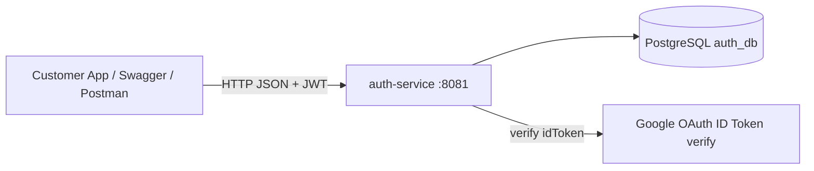
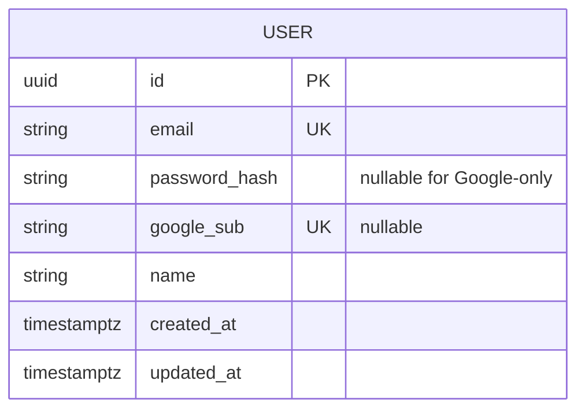
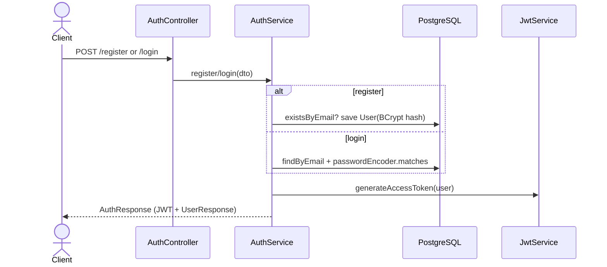
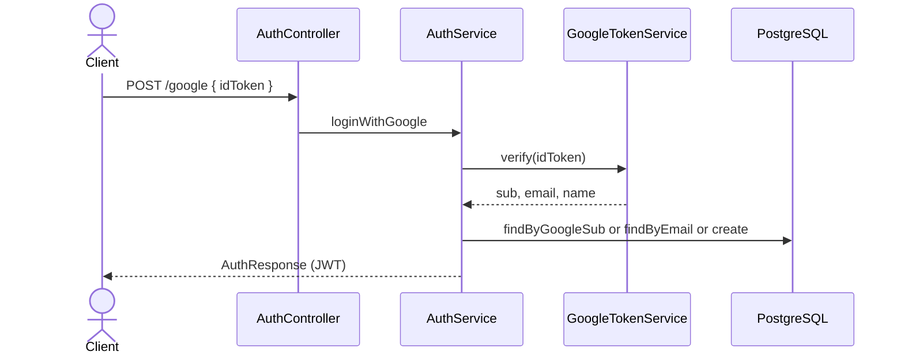
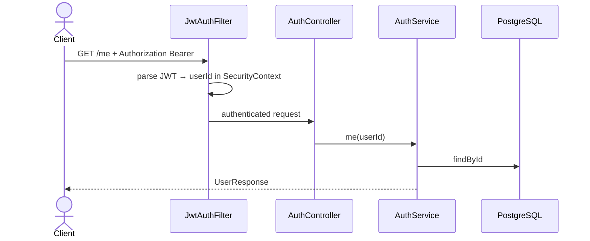
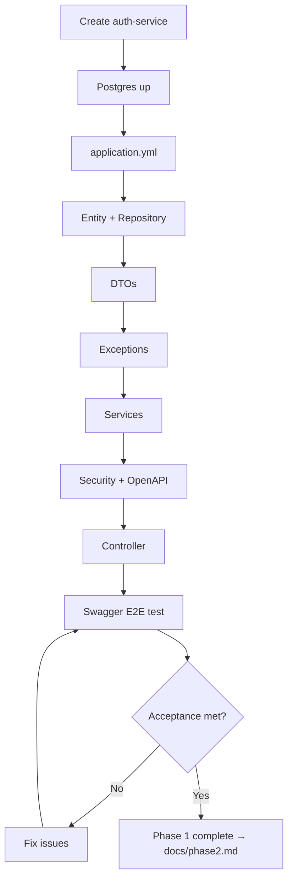

# Phase 1 — Auth Service

**Status:** Planned / In progress  
**Goal:** User register, login (password + Google), JWT issuance, Spring Security, Swagger, Postgres.  
**Out of scope:** Gateway, Kafka, Nginx, cart, order, payment, rider.

---

## 1. Phase objective

Build a standalone **auth-service** that:

- Registers users with **BCrypt**-hashed passwords
- Logs in with email/password
- Signs in with **Google ID token**
- Issues **JWT** access tokens
- Protects `/me` with Spring Security
- Exposes APIs via **Swagger (springdoc)**
- Persists users in **PostgreSQL** (Docker)

---

## 2. HLD — High Level Design

### 2.1 Context



### 2.2 What exists vs later

| Component | Phase 1 | Later phases |
|-----------|---------|--------------|
| auth-service | Yes | — |
| Postgres | Yes | Shared / more DBs |
| Redis / Kafka / Nginx | No | Phase 2+ |
| api-gateway | No | Phase 2 |
| cart / order / payment | No | Phase 3+ |
| Prometheus / Grafana | Actuator only | Full later |

### 2.3 Consistency note

Auth login/register: **consistency first** (correct user + password hash in Postgres). No async needed in Phase 1.

---

## 3. LLD — Low Level Design

### 3.1 Package structure

```text
com.superapp.auth
├── AuthServiceApplication.java
├── config
│   ├── SecurityConfig.java
│   └── OpenApiConfig.java
├── dto
│   ├── RegisterRequest.java
│   ├── LoginRequest.java
│   ├── GoogleLoginRequest.java
│   ├── AuthResponse.java
│   ├── UserResponse.java
│   └── ApiError.java
├── entity
│   └── User.java
├── exception
│   ├── ApiException.java
│   └── GlobalExceptionHandler.java
├── repository
│   └── UserRepository.java
├── security
│   └── JwtAuthFilter.java
├── service
│   ├── AuthService.java
│   ├── JwtService.java
│   └── GoogleTokenService.java
└── web
    └── AuthController.java
```

### 3.2 Data model



### 3.3 API surface

| Method | Path | Auth | Description |
|--------|------|------|-------------|
| POST | `/api/v1/auth/register` | Public | Create user + JWT |
| POST | `/api/v1/auth/login` | Public | Password login + JWT |
| POST | `/api/v1/auth/google` | Public | Google ID token + JWT |
| GET | `/api/v1/auth/me` | Bearer JWT | Current user |
| GET | `/swagger-ui.html` | Public | Swagger UI |
| GET | `/actuator/health` | Public | Health |

### 3.4 Class responsibilities

| Class | Responsibility |
|-------|----------------|
| `User` | JPA entity |
| `UserRepository` | DB access |
| `AuthService` | Register / login / Google / me |
| `JwtService` | Create & parse JWT |
| `GoogleTokenService` | Verify Google ID token |
| `JwtAuthFilter` | Bearer → SecurityContext |
| `SecurityConfig` | PermitAll vs authenticated + BCrypt |
| `AuthController` | HTTP mapping |
| `OpenApiConfig` | Swagger + Bearer scheme |

### 3.5 Security rules

- Passwords: **BCrypt only** (`PasswordEncoder`)
- Session: **STATELESS**
- CSRF: disabled for API
- Public: register, login, google, swagger, health
- Protected: `/api/v1/auth/me` and any future auth routes

---

## 4. Runtime flows

### 4.1 Register / Login



### 4.2 Google Sign-In



### 4.3 Authenticated /me



---

## 5. Build steps (checklist)

| Step | Task | Done? |
|------|------|-------|
| 1 | Create `auth-service` on start.spring.io + extra deps (jjwt, google-api-client, springdoc) | [ ] |
| 2 | Start Postgres Docker (`auth_db`) | [ ] |
| 3 | Write `application.yml` | [ ] |
| 4 | Entity `User` + `UserRepository` | [ ] |
| 5 | DTOs (+ Lombok, `@Schema`) | [ ] |
| 6 | `ApiException` + `GlobalExceptionHandler` | [ ] |
| 7 | `JwtService`, `GoogleTokenService`, `AuthService` | [ ] |
| 8 | `JwtAuthFilter`, `SecurityConfig`, `OpenApiConfig` | [ ] |
| 9 | `AuthController` | [ ] |
| 10 | Run app; test via Swagger (register → login → /me) | [ ] |

### Step meanings (short)

1. **Scaffold** — one Spring Boot app for identity only
2. **Database** — place to store users
3. **Config** — ports, DB, JWT, Google, Swagger
4. **Model** — persistence shape
5. **API contract** — request/response DTOs
6. **Errors** — consistent JSON errors
7. **Business logic** — hash, verify, tokens
8. **Security** — who can call what
9. **HTTP layer** — REST endpoints
10. **Verify** — Phase 1 acceptance

---

## 6. Dependencies (Phase 1)

- spring-boot-starter-web, validation, security
- oauth2-client, oauth2-resource-server
- data-jpa, postgresql
- actuator
- lombok
- springdoc-openapi-starter-webmvc-ui
- jjwt-api / jjwt-impl / jjwt-jackson
- google-api-client

---

## 7. Acceptance criteria

- [ ] `POST /register` creates user; password stored as BCrypt hash
- [ ] `POST /login` returns JWT
- [ ] `GET /me` with Bearer works; without token → 401
- [ ] Swagger UI loads and documents Auth APIs
- [ ] `/actuator/health` is UP
- [ ] Google endpoint present (works when real `GOOGLE_CLIENT_ID` set)

---

## 8. Phase 1 workflow (planning → done)



---

## 9. Next phase (preview only)

**Phase 2 (planned):** API Gateway + Nginx reverse proxy; other services validate JWT as resource servers.

See `docs/phase2.md` when started.

---

## 10. Related design decisions (from overall SuperApp)

- Checkout/payment later: **consistency > availability**
- Browse/cart UI later: **availability > consistency**
- Async later: **Kafka**; edge later: **Nginx**
- Phase 1: **sync only**, no Kafka
```
